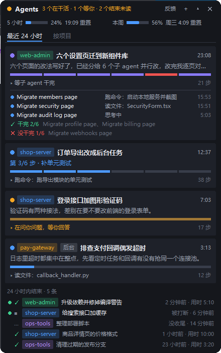

# Agent 悬浮窗

Windows 上的一个置顶小窗口，在同一个 `Agent悬浮窗.exe` 中显示本机 Claude Code 和 Codex 对话的状态、子任务进度和所属项目。Claude Code 保留发起任务、跳转编辑器和手机回复功能，有新版本时一键更新。

怎么装、怎么用，见 [使用说明.md](使用说明.md)（这份也会打进发给同事的包里）。

## 目录

- `app/`：程序本身（Python 3.8+，只用标准库和 tkinter；`segno/` 是生成二维码用的库）。入口是 `agent_hud.pyw`。
- `dev/`：测试、截图、打包脚本，不进包。
- `安装.bat` / `卸载.bat`：脚本版的安装和卸载。

## 第一次拉下来

`app/feedback_to.py` 不在仓库里：里面是反馈群机器人的地址、飞书应用的密钥和发版表的地址，只打进发给同事的包里。
把 `dev/feedback_to_example.py` 复制成 `app/feedback_to.py`，按里面的说明填上自己的值。全空着也能跑，只是反馈发不出去、不检查新版本。

## 测试

`dev/test_*.py` 每个都能单独跑（`python dev/test_collector.py`），最后一行是「全部通过」或者失败了哪几项。
测试都在临时目录里跑，不碰本机的设置；`test_exe.py` 和 `test_codex_exe.py` 要先打好 exe。

`dev/test_codex.py` 覆盖两类会话混合显示、Codex 父子任务合并、桌面已读同步和旧缓存恢复。Codex 读取逻辑在 `app/codex_collector.py`，与 Claude Code 共用原来的列表、设置、安装入口和打包流程。

## 打包、发版

1. 改 `app/agent_hud.pyw` 里的 `VERSION`（三段：1.0.1、1.1.0……）。
2. 跑全部 `dev/test_*.py`。
3. `python dev/build_exe.py`：在 `dev/.venv-build` 里装 PyInstaller，打出 `Agent悬浮窗.exe` 和 `_internal/`，然后跑 `python dev/test_exe.py`。
4. `python dev/pack.py`：打成 `build/agent-hud-<版本>.zip`。
5. 在飞书的发版表里加一行（版本、说明），把 zip 拖进「安装包」那一格。装着的悬浮窗会提示有新版本，点「立即更新」就换好了。
